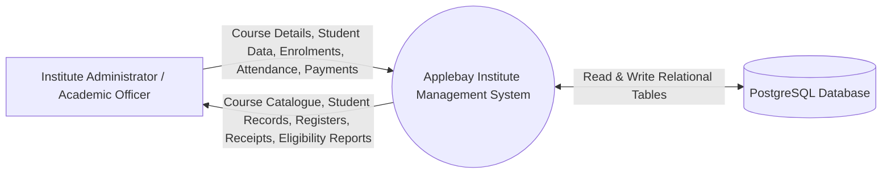
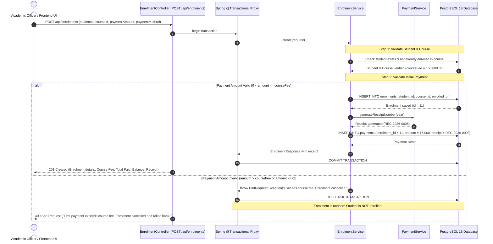

# Applebay Institute - Data Flow & Transaction Sequence Diagrams

## 1. Context Diagram (Level 0 DFD)

---

## 2. Level 1 Data Flow Diagram (DFD)

```mermaid
flowchart TD
    Officer[Administrator / Officer]

    subgraph SystemProcesses [System Processes]
        P1[1.0 Course Management]
        P2[2.0 Student Management]
        P3[3.0 Unified Enrolment & Payment Management]
        P4[4.0 Attendance Management]
        P5[5.0 Tuition Payment & Receipts]
    end

    subgraph DataStores [Data Stores]
        D1[(D1: Courses)]
        D2[(D2: Students)]
        D3[(D3: Enrolments)]
        D4[(D4: Attendance)]
        D5[(D5: Payments)]
    end

    Officer -->|Course Info| P1
    P1 -->|Store / Update Course| D1
    D1 -->|Course List & Fees| P1
    P1 -->|Course Reports| Officer

    Officer -->|Student Profile Info| P2
    P2 -->|Create / Update Student| D2
    D2 -->|Search Student Profile| P2
    P2 -->|Student Records| Officer

    Officer -->|Enrolment Request & Initial Payment| P3
    P3 -->|Validate Student & Course Fee| D1
    P3 -->|Validate Student & Course Fee| D2
    P3 -->|Save Enrolment & First Payment Atomically| D3
    P3 -->|Save Enrolment & First Payment Atomically| D5
    P3 -->|Enrolment Details & Receipt| Officer

    Officer -->|Daily Session Marks| P4
    P4 -->|Verify Active Enrolment| D3
    P4 -->|Store / Update Attendance| D4
    D4 -->|Calculate Attendance % & 80% Rule| P4
    P4 -->|Attendance Sheets & Exam Eligibility| Officer

    Officer -->|Subsequent Installment Payment| P5
    P5 -->|Check Remaining Balance| D1
    P5 -->|Check Remaining Balance| D3
    P5 -->|Read Total Paid| D5
    P5 -->|Generate Receipt & Record Payment| D5
    P5 -->|Payment Receipt & Outstanding Dues| Officer
```

---

## 3. Atomic Transaction & Data Flow (Section 4.3): Course Enrolment & Initial Payment

The brief specifies: *"Registration of a student, enrollment and first payment should succeed or fail together (transaction and rollback)"*.

Once a student is registered, when enrolling them into a course, the first payment must be paid simultaneously. If the initial payment amount is invalid (e.g. exceeds course fee, negative/zero), the transaction rolls back completely and the student is **not** enrolled.

