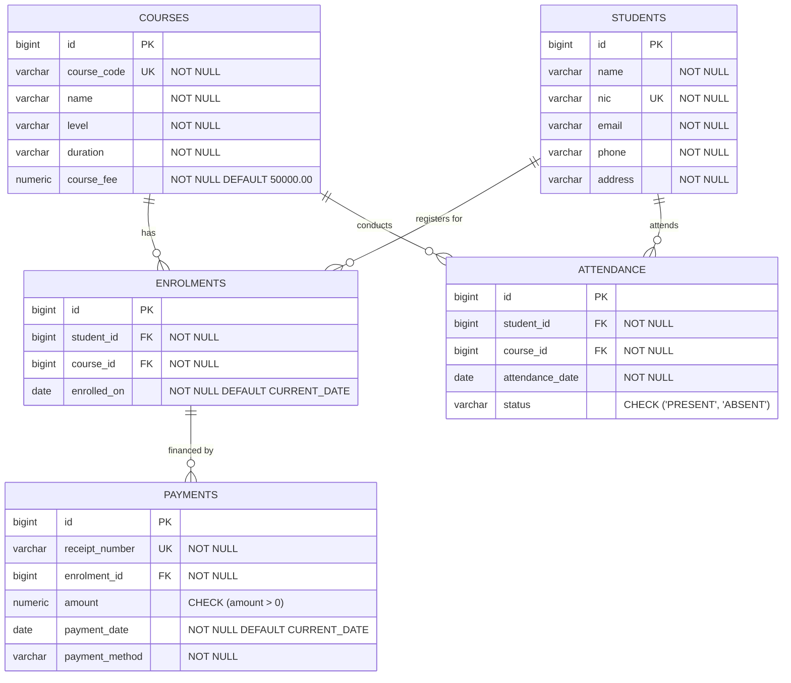

# Applebay Institute - Entity Relationship (ER) Diagram

## Conceptual Model & Relationships

## Relational Schema Specifications

1. **`courses`**:
   - `id` (PK, BIGSERIAL)
   - `course_code` (VARCHAR(20), UNIQUE, NOT NULL)
   - `name` (VARCHAR(150), NOT NULL)
   - `level` (VARCHAR(50), NOT NULL)
   - `duration` (VARCHAR(50), NOT NULL)
   - `course_fee` (NUMERIC(10, 2), NOT NULL DEFAULT 50000.00)

2. **`students`**:
   - `id` (PK, BIGSERIAL)
   - `name` (VARCHAR(150), NOT NULL)
   - `nic` (VARCHAR(20), UNIQUE, NOT NULL)
   - `email` (VARCHAR(150), NOT NULL)
   - `phone` (VARCHAR(20), NOT NULL)
   - `address` (VARCHAR(255), NOT NULL)

3. **`enrolments`**:
   - `id` (PK, BIGSERIAL)
   - `student_id` (FK referencing `students(id)` ON DELETE CASCADE, NOT NULL)
   - `course_id` (FK referencing `courses(id)` ON DELETE CASCADE, NOT NULL)
   - `enrolled_on` (DATE, NOT NULL DEFAULT CURRENT_DATE)
   - Unique Constraint: `(student_id, course_id)`

4. **`attendance`**:
   - `id` (PK, BIGSERIAL)
   - `student_id` (FK referencing `students(id)` ON DELETE CASCADE, NOT NULL)
   - `course_id` (FK referencing `courses(id)` ON DELETE CASCADE, NOT NULL)
   - `attendance_date` (DATE, NOT NULL)
   - `status` (VARCHAR(10), CHECK IN ('PRESENT', 'ABSENT'))
   - Unique Constraint: `(student_id, course_id, attendance_date)`

5. **`payments`**:
   - `id` (PK, BIGSERIAL)
   - `receipt_number` (VARCHAR(30), UNIQUE, NOT NULL)
   - `enrolment_id` (FK referencing `enrolments(id)` ON DELETE CASCADE, NOT NULL)
   - `amount` (NUMERIC(10, 2), CHECK (amount > 0), NOT NULL)
   - `payment_date` (DATE, NOT NULL DEFAULT CURRENT_DATE)
   - `payment_method` (VARCHAR(30), NOT NULL)

